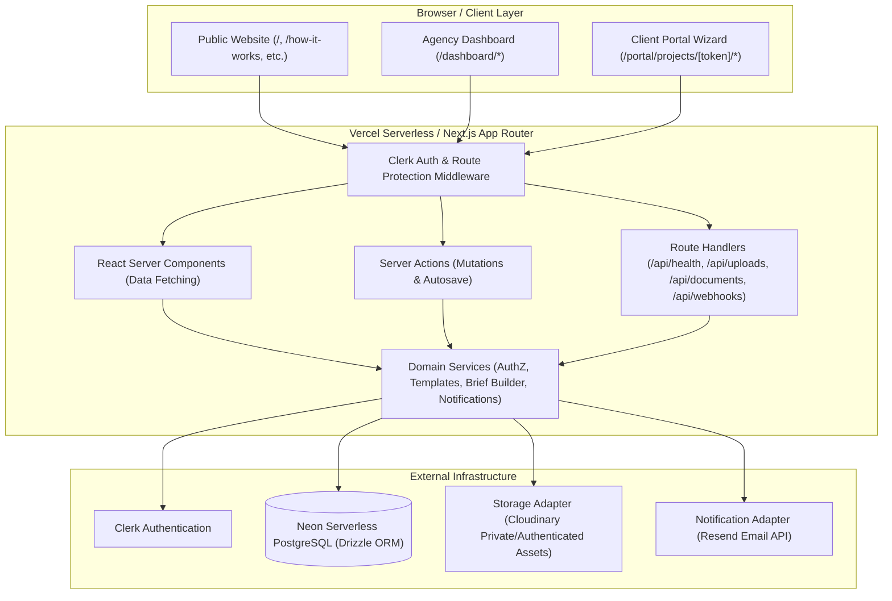
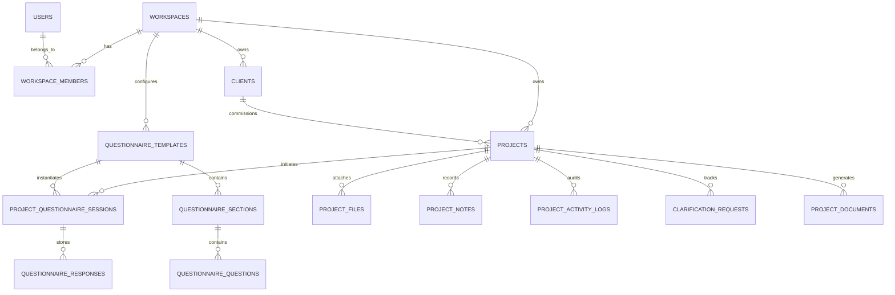

# WebStart — System Architecture (`Architect.md`)

**Product:** WebStart — Client Discovery, Website Requirements & Project Initiation Platform  
**Target Deployment:** Vercel Serverless (Free Tier)  
**Primary Stack:** Next.js (App Router), TypeScript, Tailwind CSS, shadcn/ui, Neon PostgreSQL, Drizzle ORM, Clerk Auth, Cloudinary, Resend  
**Package Manager & Runtime Tooling:** Bun  

---

## 1. Architectural Overview

WebStart is a multi-tenant, serverless full-stack web application built on **Next.js App Router**. It provides two primary user experiences backed by a shared relational data model and strict workspace-level isolation:

1. **Agency Workspace (`/dashboard/*`)**: Role-based administrative portal for Super Administrators, Agency Administrators, and Project Managers to manage clients, configure adaptive discovery templates, initiate projects, issue secure client invitations, review submissions, request clarifications, and generate structured 20-section project briefs (HTML, Markdown, and PDF).
2. **Client Discovery Portal (`/portal/*`)**: Mobile-optimized, token-authenticated and/or Clerk-authenticated guided wizard where clients complete adaptive, section-by-section website discovery questionnaires with debounced server-confirmed autosave, conditional follow-up logic, file uploads, and clarification response flows.
3. **Public Marketing & Onboarding Entry (`/`, `/about`, `/how-it-works`, `/contact`, `/privacy`, `/terms`, `/sign-in`, `/sign-up`)**: Fast, statically generated (or hybrid) public pages explaining the discovery workflow.



---

## 2. Key Architectural Decisions (ADRs)

### ADR-01: Next.js App Router with Server Components & Server Actions
- **Decision**: Use React Server Components (RSC) for initial data reads and Next.js Server Actions + dedicated Route Handlers for mutations, file uploads, PDF/Markdown exports, and health checks.
- **Rationale**: Eliminates redundant API boilerplate, keeps database queries and authorization checks strictly on the server, and runs statelessly within Vercel's Hobby/Free tier limits.

### ADR-02: Hybrid Authentication Model (Clerk + Hashed Session Invitation Tokens)
- **Decision**:
  - Agency staff (`SUPER_ADMIN`, `ADMIN`, `PROJECT_MANAGER`) authenticate via **Clerk** and are mapped to internal PostgreSQL `users` and `workspace_members` records.
  - Clients can access assigned questionnaires via **cryptographically random invitation tokens** (`/portal/projects/[token]`) alongside optional or linked Clerk client accounts (`/portal`).
  - Raw invitation tokens (256-bit entropy URL-safe strings) are generated once/regenerated on demand; only their **SHA-256 hash** (`invitation_token_hash`) is persisted in `project_questionnaire_sessions`, accompanied by `expires_at` and `revoked_at` timestamps.
- **Rationale**: Frictionless client onboarding is critical for agency discovery response rates while maintaining strong security through hashed tokens, expiration, revocation, and optional Clerk identity binding.

### ADR-03: Multi-Tenancy & Strict Server-Side Authorization
- **Decision**: Every tenant-scoped table (`clients`, `projects`, `questionnaire_templates`, etc.) is linked to a `workspace_id`. Authorization is enforced in a centralized server guard (`requireWorkspaceRole` / `requireProjectAccess`) rather than relying on client-editable Clerk metadata or UI route hiding.
- **Rationale**: Prevents Insecure Direct Object Reference (IDOR) vulnerabilities and ensures future readiness for multi-agency workspaces without schema rewrites.

### ADR-04: Adaptive Versioned Questionnaire Engine with JSONB Responses
- **Decision**:
  - Store templates in relational tables (`questionnaire_templates`, `questionnaire_sections`, `questionnaire_questions`) with JSONB columns for `options`, `validation_rules`, and `conditional_rules`.
  - When a project session is created (`project_questionnaire_sessions`), snapshot the `template_version` (and an immutable template definition snapshot) so subsequent template edits never corrupt historical or in-flight client submissions.
  - Store answers per question in `questionnaire_responses` (`session_id`, `question_id`, `question_key`, `section_key`, `response_value` JSONB) with an `UNIQUE(session_id, question_id)` constraint to support idempotent `ON CONFLICT DO UPDATE` autosaves.
- **Rationale**: Combines relational integrity and queryability with flexible support for scalar inputs, multi-select arrays, dynamic page builders (Section 4), and conditional feature follow-up groups (Section 6).

### ADR-05: Provider-Independent Storage Adapter (Cloudinary Default)
- **Decision**: Define a `StorageProvider` TypeScript interface (`uploadFile`, `getSignedDownloadUrl`, `deleteFile`) in `src/lib/storage/`. Implement a `CloudinaryStorageAdapter` (using server-side signed uploads/downloads) and a fallback/mock adapter for local testing when credentials are unconfigured.
- **Rationale**: Prevents vendor lock-in, protects private client files from predictable public URLs, and verifies file signatures (magic bytes) and sizes on the server before upload.

### ADR-06: Deterministic Rule-Based Document Generation & Serverless PDF Export
- **Decision**:
  - Build a deterministic `ProjectBriefBuilder` service that transforms persisted client details, questionnaire responses, agency review notes (explicitly filtered to exclude private internal-only notes unless marked for brief observations), and clarification history into a structured 20-section representation.
  - Strictly separate **Client-Provided Information**, **Agency Observations**, **Technical Recommendations**, and **Unconfirmed Assumptions**.
  - Support HTML preview, printable CSS view, Markdown export, and serverless-compatible PDF generation (`pdf-lib` / `@react-pdf/renderer` without requiring a heavy headless Chromium binary exceeding Vercel serverless bundle size limits).
  - Designed with a clean analyzer interface so AI-assisted insights can be plugged in later without overwriting raw client responses.

### ADR-07: Graceful Degradation for Optional Integrations (Resend, Cloudinary, Turnstile)
- **Decision**: Wrap external integrations (Resend email delivery, Cloudinary storage, Cloudflare Turnstile) with capability checks. If `RESEND_API_KEY` is absent, the platform records the notification log as `SKIPPED_UNCONFIGURED`, displays a clear banner to administrators, and surfaces the one-click copyable invitation URL so the core workflow never breaks.

---

## 3. Directory Structure

```text
webstart/
├── docs/
│   ├── DATABASE.md              # Schema reference, ER diagram, indexing & migration guide
│   ├── DEPLOYMENT.md            # Vercel, Neon, Clerk, Cloudinary, Resend setup & limits
│   ├── IMPLEMENTATION_PLAN.md   # Phased implementation roadmap & status checklist
│   └── SECURITY.md              # RBAC, token hashing, upload validation, NDPA privacy notes
├── drizzle/                     # Generated SQL migrations and metadata
├── public/                      # Static assets, icons, brand logos
├── src/
│   ├── app/
│   │   ├── (public)/            # /, /about, /how-it-works, /contact, /privacy, /terms
│   │   ├── (auth)/              # /sign-in/[[...sign-in]], /sign-up/[[...sign-up]]
│   │   ├── dashboard/           # Agency portal (/dashboard, /clients, /projects, /templates, /users, /settings)
│   │   ├── portal/              # Client portal (/portal, /portal/projects/[token], /review, /submitted)
│   │   └── api/                 # Route handlers (/api/health, /api/uploads, /api/projects/[id]/brief/pdf, etc.)
│   ├── components/
│   │   ├── ui/                  # shadcn/ui primitives
│   │   ├── layout/              # Sidebar, topbar, mobile nav, theme toggle, workspace switcher
│   │   ├── dashboard/           # Metrics cards, status badges, charts, activity feed
│   │   ├── clients/             # Client forms, table, filters, detail view
│   │   ├── projects/            # Project wizard, invitation dialog, review panel, clarification modal
│   │   ├── questionnaire/       # Wizard shell, section renderer, conditional fields, autosave indicator
│   │   └── documents/           # 20-section brief viewer, print view, export controls
│   ├── db/
│   │   ├── index.ts             # Neon serverless connection & Drizzle instance
│   │   ├── schema.ts            # Complete relational schema & relations
│   │   └── seed.ts              # Default workspace & 7 adaptive questionnaire templates seed script
│   ├── lib/
│   │   ├── auth/                # Clerk sync, RBAC guards, workspace isolation, token hashing
│   │   ├── questionnaire/       # Template definitions, conditional rule evaluator, completion calculator
│   │   ├── brief/               # Rule-based 20-section project brief generator, Markdown & PDF exporters
│   │   ├── storage/             # StorageProvider interface + Cloudinary adapter + magic-byte validator
│   │   ├── notifications/       # EmailProvider interface + Resend adapter + HTML templates
│   │   ├── validations/         # Shared Zod schemas (clients, projects, responses, files, clarifications)
│   │   ├── rate-limit.ts        # Serverless-safe rate limiting utility
│   │   └── utils.ts             # Formatting, cn(), error handling helpers
│   └── actions/                 # Server Actions (clients, projects, questionnaire, review, clarifications, templates)
├── tests/
│   ├── unit/                    # Vitest unit tests (validation, RBAC, conditional engine, completion %, tokens)
│   ├── integration/             # Integration tests (persistence, autosave, brief builder, status transitions)
│   └── e2e/                     # Playwright end-to-end journey & mobile responsiveness tests
├── .env.example
├── Architect.md
├── CHANGELOG.md
├── drizzle.config.ts
├── next.config.ts
├── package.json
├── README.md
├── skills.md
└── tsconfig.json
```

---

## 4. Database Schema & Entity Model

All tables use UUID primary keys (`defaultRandom()`), `created_at` / `updated_at` timestamps, foreign key constraints, and targeted composite indexes.



### Core Enums & Status Flows
- **Workspace Roles (`workspace_role`)**: `SUPER_ADMIN`, `ADMIN`, `PROJECT_MANAGER`, `CLIENT`
- **Project Statuses (`project_status`)**:
  `DRAFT` → `INVITATION_SENT` → `IN_PROGRESS` → `SUBMITTED` → `UNDER_REVIEW` ⇄ `AWAITING_CLIENT_RESPONSE` → `APPROVED` → `ARCHIVED`
- **Website Categories (`website_category`)**:
  `CORPORATE`, `ECOMMERCE`, `EDUCATION`, `NGO`, `PORTFOLIO`, `WEB_APP`, `CUSTOM`
- **Section Review Statuses**: `PENDING`, `REVIEWED`, `FLAGGED`, `NEEDS_CLARIFICATION`

---

## 5. Adaptive Questionnaire & Conditional Logic Engine

### Standard 11 Core Discovery Sections
1. `client_business_info` — Client & Business Information
2. `project_objectives` — Project Objectives
3. `target_audience` — Target Audience
4. `website_structure_content` — Website Structure & Content (with per-page details & custom page builder)
5. `design_branding` — Design & Branding (colours, style, references, logo/asset uploads)
6. `functional_requirements` — Functional Requirements + **Conditional Feature Follow-Up Groups** (Online Payments, Booking, User Accounts, E-Commerce, etc.)
7. `technical_infrastructure` — Technical & Infrastructure Requirements (never collecting passwords/secrets)
8. `content_management` — Content Management & Governance
9. `budget_timeline` — Budget & Timeline
10. `legal_compliance` — Legal & Compliance (including NDPA/GDPR privacy considerations)
11. `final_review_submission` — Final Review, Completeness Verification & Explicit Submission

### Category-Specific Adaptive Sections
Each of the 7 templates (`Corporate`, `E-commerce`, `Educational Institution`, `NGO / Non-profit`, `Personal / Portfolio`, `Web Application / Customer Portal`, `Custom Website`) includes the core sections plus its specialized domain section(s) (e.g., `education_specifics`, `ngo_specifics`, `ecommerce_specifics`, `corporate_specifics`, `custom_workflows`).

### Conditional Rule Evaluation
Each question or question group supports declarative `conditional_rules` in JSONB:
```json
{
  "operator": "AND",
  "conditions": [
    { "questionKey": "selected_features", "comparator": "INCLUDES", "value": "online_payments" }
  ]
}
```
Both the client wizard and the server-side completion/validation engine evaluate the exact same pure TypeScript rule evaluator (`evaluateConditionalRules`), ensuring that hidden unselected follow-up questions are not counted against required completion percentages.

---

## 6. Security & Compliance Architecture

1. **Authentication & RBAC Enforcement**:
   - Every `/dashboard/*` route and administrative Server Action validates the active Clerk session, resolves the PostgreSQL user and workspace membership, and checks the role matrix.
   - `CLIENT` users and token sessions can never read `project_notes` where `visibility = 'INTERNAL'`.
2. **Invitation Token Security**:
   - Generated using `crypto.randomBytes(32).toString('base64url')`.
   - Stored exclusively as `sha256(token)` in `project_questionnaire_sessions.invitation_token_hash`.
   - Checked for expiration (`expires_at`), revocation (`revoked_at`), and submission lock state (`submitted_at` unless reopened or in `AWAITING_CLIENT_RESPONSE`).
3. **File Upload Hardening**:
   - Strict whitelist of extensions and MIME types (`image/png`, `image/jpeg`, `image/webp`, `image/svg+xml` sanitized, `application/pdf`, `application/vnd.openxmlformats-officedocument.wordprocessingml.document`).
   - Server-side magic-byte inspection (`file-type` / buffer header check) and maximum size enforcement (e.g., 10 MB per file).
   - Authenticated download endpoint (`/api/files/[id]/download`) that verifies workspace or project session ownership before streaming or issuing a short-lived signed URL.
4. **Data Protection & Privacy**:
   - Explicit warning in Section 7 never to enter passwords or secret keys.
   - Support for client archiving, file deletion, and full data export in line with the **Nigeria Data Protection Act (NDPA)** and global privacy standards.
5. **Audit Trail**:
   - Every critical mutation (project created, invitation sent/revoked, questionnaire submitted/reopened, clarification requested/resolved, discovery approved, brief generated) writes an immutable entry to `project_activity_logs`.
